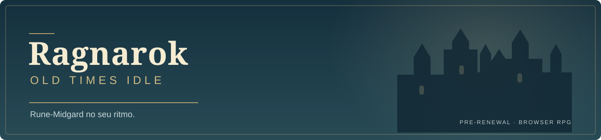

# Ragnarok Old Times Idle

**A browser idle RPG inspired by classic Ragnarok Online.** Explore Rune-Midgard, develop your class and prepare your character to keep hunting between sessions.

### [Play the test version →](https://187.77.238.51:8443/)

[Alchemy (PT-BR)](docs/ALCHEMY.md) · [Português](README.md) · [Getting started](#start-your-adventure) · [Setup guide](docs/SETUP.md) · [Contributing](CONTRIBUTING.md)

 

## Start your adventure

1. Open the test portal and create an account or sign in.
2. Select your character and a hunting area. Your character finds existing monsters, walks to them and fights automatically.
3. Arrange skills, allocate stats and improve equipment to progress.

The hosted test opens in your browser; players do not need Docker or a local server. Enable music inside the game to hear the map's soundtrack.

## Explore, progress and prepare

- Fields and dungeons with monsters, mini-bosses and MVP challenges.
- Classic class progression, rebirth and attributes.
- Equipment, cards, identification, rarity tiers and refining.
- AFK hunting with movement, individual respawns and up to 12 hours of offline progress.
- Automatic skill priorities, casting, range and cooldowns resolved by the server.
- A classic-inspired movable HUD, inventory, combat diary and chat; shops, refining and styling in Prontera.

See the [Weapon Refinement guide](docs/WEAPON_REFINEMENT.md) for the paid skill menu, native chances and destruction risk (Portuguese).

See the [Falcon companion guide](docs/FALCON.md) for rental, automatic attacks and Detect (Portuguese).

## Project status

This is an independent fan project under active development.

| Content in the current source | Count |
| --- | ---: |
| Hunting areas | 38 |
| Classes in the progression trees | 40 |
| Skills imported from Hercules | 348 |
| Implemented skills | 274 |

Unavailable mechanics are identified in the game. Idle progression adapts some rules and rewards; full reproduction of every original system and effect is still in progress. See the [catalog](idle/content/) and [source manifest](idle/content/source-manifest.json).

### Inventory consumables

Use regular and condensed potions, Anodyne, Aloevera and elemental resistance potions from the inventory. Manual and automatic recovery share the same calculation. See [alchemy effects and current limits](docs/ALCHEMY.md).

## Development and hosting

Built with **TypeScript, React, Fastify and MariaDB**, using Docker Compose. The Idle engine has separate progression; the classic client uses Hercules and roBrowserLegacy.

- [Setup and hosting](docs/SETUP.md) — installation, client assets, services and troubleshooting (Portuguese).
- [Development](docs/DEVELOPMENT.md) — architecture, commands, tests and content export (Portuguese).
- [Contributing](CONTRIBUTING.md) — bug reports and focused changes (Portuguese).
- [Issues](https://github.com/djowww/ragnarok-old-times-idle/issues) — known problems and suggestions.

## License and attribution

Not affiliated with or endorsed by Gravity Co., Ltd. Source code is licensed under **GPL v3 or later**. See [LICENSE](LICENSE) and [third-party notices](idle/THIRD_PARTY_NOTICES.md).

Original Ragnarok maps, sprites, effects, icons and music are not included in this repository. Operators must provide client resources they are authorized to use; the code license does not grant rights to those assets.
