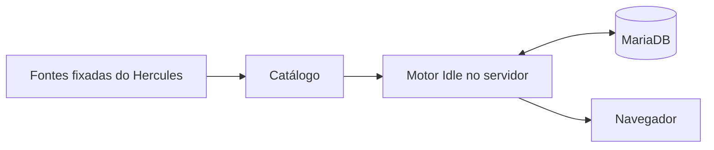

# Desenvolvimento

[Voltar ao projeto](../README.md) · [Instalação](SETUP.md) · [Como contribuir](../CONTRIBUTING.md)

## Estrutura do código

| Diretório | Responsabilidade |
| --- | --- |
| `idle/engine/` | Simulação autoritativa, progressão e regras de combate |
| `idle/server/` | API, autenticação, persistência e scheduler |
| `idle/web/` | Interface, HUD e apresentação da batalha |
| `idle/content/` | Catálogo e fontes fixadas do Hercules |
| `idle/tests/` | Regressões do motor, API e apresentação |
| `docker/` | Serviços e adaptações do cliente clássico |
| `tools/` | Política e verificações de publicação |



O motor Idle tem progresso próprio. O cliente clássico e a instância do Hercules são componentes separados da stack. Assets do cliente são fornecidos pelo operador, fora do Git.

## Comandos

O pacote do idle usa Node.js 24 e pnpm 11.25.0. Com Docker ativo, instale as dependências e execute os comandos na pasta `idle/`:

```powershell
pnpm install --frozen-lockfile
pnpm test
pnpm typecheck
pnpm build
pnpm dev
```

Para uma verificação focada, use `pnpm exec vitest run tests/hosting.test.ts`.
A suíte local informa os testes SQL/assets opcionais ignorados. A verificação
completa requer banco **descartável**, recursos reais e execução serial:

Antes deste bloco Docker, volte à raiz do repositório (se estiver em `idle/`,
execute `cd ..`). Os caminhos de build abaixo são relativos à raiz.

```powershell
docker run --rm -d --name ragidle-portal-test-db --network ragidle_ragnarok_local -e MARIADB_DATABASE=idle_portal_test -e MARIADB_USER=idle_test -e MARIADB_PASSWORD=idle_test_local -e MARIADB_ROOT_PASSWORD=idle_test_root_local mariadb:11.4
# Aguarde a prontidão do banco temporário antes dos testes.
docker build --target dependencies -t ragidle-portal-tests -f docker/idle-game/Dockerfile idle
docker run --rm --network ragidle_ragnarok_local -e DB_HOST=ragidle-portal-test-db -e DB_NAME=idle_portal_test -e DB_USER=idle_test -e DB_PASSWORD=idle_test_local -e IDLE_DB_TEST=1 -e IDLE_ASSET_ORIGIN=http://asset-service:8080 ragidle-portal-tests node node_modules/vitest/vitest.mjs run --no-file-parallelism
docker stop ragidle-portal-test-db
```

Essas credenciais são exclusivas do banco de testes, que não monta o volume
do jogador nem publica porta. Não use esse banco para navegador ou scheduler.
Não execute fixtures SQL na instalação real. Para comprovar início de volume
novo e persistência, use outro projeto Compose com sua própria rede, volume,
contas QA e porta local; preserve seus dados durante o reinício de teste.

O Vite abre em `http://localhost:5173/` e encaminha API e assets para a stack local. Para reconstruir o serviço idle servido pelo Docker, volte à raiz e execute:

```powershell
docker compose up --build -d idle-game
```

O catálogo, as regras de seleção e as adaptações do idle estão documentados em [`idle/content/`](../idle/content/). O exportador compara hashes com as fontes fixadas do Hercules e trata scripts de itens como dados, sem executá-los. Para regenerar o catálogo, inicie a stack e use:

```powershell
Set-Location idle
pnpm export-content
```


## Publicação segura

Antes de enviar uma alteração:

```sh
python3 tools/test_publication_guard.py
python3 tools/check-publication.py
python3 tools/check-publication.py --history
gitleaks git --log-opts=--all --redact=100 --no-banner
```

A exceção para a URL pública do jogo é limitada aos arquivos indicados na política. Credenciais, configurações reais, bancos, backups e relatórios internos não pertencem ao repositório. Veja também [AGENTS.md](../AGENTS.md).
